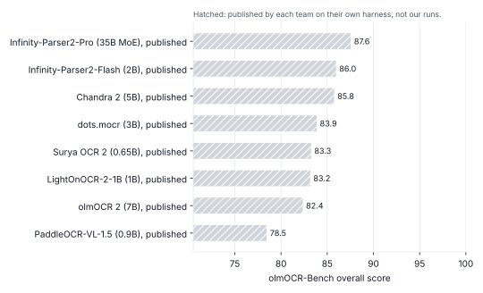

# Folio-OCR

A page parser fine-tuned from **Infinity-Parser2-Flash** (2B parameters, Apache-2.0): page image in, layout
JSON and Markdown out. It is the code for the plan *"Plan: an OCR that beats Chandra, Surya and Infinity-Parser"*,
built to run on **free GPUs** (Kaggle T4 x2, free Colab T4).

On free GPUs the realistic target is **Tier A**: the best resume reader of every model tested, on real resumes. The general-benchmark tiers (beating Chandra 2 / Infinity-Parser2 on olmOCR-Bench) need roughly 300+ H100-hours. All of their code is here and runs on free hardware, but scaled down: LoRA instead of a full fine-tune, tens of thousands of pages instead of a million, RL on page bands instead of full pages.

| Plan phase | What is here | Notebook |
|---|---|---|
| 0. Harness and baselines | `bench_olmocr.py`, `bench_resume.py`, `bench_dev.py`, `bench_omnidoc.py`, `compare.py`, `speed_test.py` | `folio_phase0_phase1` |
| 1. Resume model | synthetic page renderer, `train_sft.py` (4-bit LoRA on a T4), `infer.py` | `folio_phase0_phase1` |
| 2. Data engine and SFT | `prepare_data.py` (olmOCR-mix, olmOCR-synthmix, Infinity-Doc2-5M, LightOnOCR-mix), `dedup.py` (contamination), `label_teachers.py` (two-teacher labels), `mixtures/`, `make_data_card.py` | `folio_phase2_4` |
| 3. RL with checkable rewards | `make_rl_set.py` (page bands with their own tests), `train_rl.py` (GRPO: unit tests, edit distance, TEDS, fields, format) | `folio_phase2_4` |
| 4. Compress, verify, release | `merge_lora.py` (merge, checkpoint averaging, 4/8-bit), `draft_holdout_tests.py`, `make_model_card.py` | `folio_phase2_4` |

`docs/PHASES.md` maps every gate of the plan (G0–G4) to the commands that decide it.

## Where the field stands



Published by each team, read on 27 October 2026. Folio-OCR's own bar appears here after the gate runs in `docs/PHASES.md`.

## What was checked, and what was not

Checked here, on CPU:

- **Tests:** 53 pass, in about two minutes.
- **The training path learns:** a tiny random model of the same architecture (Qwen3.5, Gated-DeltaNet layers) trains on one page with this code's dataset, loss and LoRA. It then generates, and the parser recovers exactly the labelled blocks.
- **GRPO learns:** on a toy reward, the tiny model's reward climbs from 0.01 to over 0.95 in 25 steps. Answer log-probabilities match a full forward pass to 1e-5.
- **The RL command line runs end to end:** with the real rewards and a KL term, it saves, resumes, runs dev evaluation and writes sample dumps, and runs as two processes.
- **Rewards and RL items agree:** on 209 RL items cut from rendered pages, the exact label scores 1.0 on every item. Damage costs what it should: a missing table scores 0 on TEDS, a phone-number typo lowers the field score, a loop scores 0, and writing nothing scores below 0.1.
- **Merging is exact:** a merged model's logits match the PEFT model's to 1e-4. Averaging two adapters equals the base plus the averaged deltas.
- **Contamination check:** each signal (image hash, text MinHash, benchmark test strings, file hash) finds its planted copy and leaves unrelated pages alone. Image-hash distances were measured on rendered pages: a re-encoded copy is 2–8 bits of 256 away, a different page at least 64.
- **Adapters, teachers and holdout drafting:** each runs on a fixture built in the layout its dataset card describes.
- **Labels and tests agree (Phase 1):** on rendered pages, ground-truth Markdown passes 100% of the unit tests generated for them.
- **Scorer matches olmOCR-Bench:** this repo's scorer reproduces olmOCR's official `benchmark.py` exactly (73.0 vs 73.0).
- **Prompts are Infinity-Parser2's own,** byte for byte, and image resizing matches qwen-vl-utils exactly.

**Not checked,** because this workspace had no GPU and could not download models or datasets:

- **The real 2B model:** running it at all, and its training speed, memory use and RL throughput on a T4.
- **Flash's output format:** whether it writes a ```` ```json ```` fence, and how it writes formula blocks. Step 3a of the first notebook shows you.
- **Bitsandbytes quantisation:** needs CUDA.
- **The Chandra and Surya command-line tools** on real hardware.
- **The real dataset files:** the adapters follow the dataset cards. Infinity-Doc2-5M is gated, so check its first converted pages with `prepare_data.py preview`.

## Licences of the training data (read before Phase 2)

- **Infinity-Doc2-5M** is **CC BY-NC-SA 4.0 and gated for academic use only**. A model trained on it is non-commercial.
  - `train_sft.py` refuses such a mixture unless you pass `--allow-noncommercial`.
  - The free mixture (`mixtures/general-free-v1.json`) leaves it out.
- **olmOCR-mix and olmOCR-synthmix** are ODC-BY. Their transcriptions were written by GPT-4.1 and Claude, so have a lawyer look before any commercial use (the plan's rule).
- **LightOnOCR-mix** falls under Common Crawl's and Digital Corpora's terms.
- **Each converted folder** gets a `source.json` with its licence line, and `make_data_card.py` turns these into the data card.

## Setup (EndeavourOS, global Python)

```bash
# rendering, scoring, data conversion and the tests that don't need torch
pip install --user --break-system-packages -r requirements.txt
pip install --user --break-system-packages --no-deps olmocr==0.4.27
python -m playwright install chromium      # if Chromium won't start: sudo pacman -S chromium (pulls its libraries)
python fetch_assets.py --fonts-from ../ResumeOCR-Lite/fonts   # or just: python fetch_assets.py  (~85 MB)
python -m pytest -q tests                  # model tests skip without torch

# only if you also want to train or run the model locally (CPU works for tests, not for real training)
pip install --user --break-system-packages -r requirements-train.txt
```

Training and real inference run on Kaggle or Colab: `notebooks/folio_phase0_phase1.ipynb`, then `notebooks/folio_phase2_4.ipynb`.

## Phase 1 in five commands

```bash
# 1. data on your own computer (CPU only), then upload data/ as a Kaggle dataset
python -m folioocr.render.make_dataset --out data/resumes --n 5000 --workers 6 --mix resume=1 --prefix r --preview 20
python -m folioocr.render.make_dataset --out data/general --n 2500 --workers 6 --prefix g --start-seed 1000000 \
    --mix "article=0.35,table=0.3,math=0.15,letter=0.1,indic=0.1"

# 2. (GPU) the base model on held-out dev pages
python bench_dev.py --labels data/resumes/labels.jsonl --tests data/resumes/tests.jsonl --name flash_base --batch-size 4

# 3. (GPU) fine-tune; on Kaggle's two T4s prefix with: accelerate launch --num_processes 2 --mixed_precision fp16
python train_sft.py --profile t4 --data data/resumes/labels.jsonl:3 data/general/labels.jsonl:2 \
    --dev data/resumes/labels.jsonl --dev-tests data/resumes/tests.jsonl --out runs/resume-t4 --epochs 1 --resume

# 4. (GPU) the fine-tune on the same pages, and the paired comparison
python bench_dev.py --labels data/resumes/labels.jsonl --tests data/resumes/tests.jsonl --name resume_v1 \
    --adapter runs/resume-t4/adapter --batch-size 4
python compare.py results/dev/resume_v1.json results/dev/flash_base.json

# 5. use it
python infer.py my_resume.pdf --adapter runs/resume-t4/adapter --json
```

Synthetic dev pages show learning. **Gate G1 is decided on Resume-Bench**: real resumes, built once with ResumeOCR-Lite's ground-truth tools. Every engine keeps page headers and footers there, since a resume's footer can hold its email.

```bash
python bench_resume.py build --gt ../ResumeOCR-Lite/data/realtest/gt.jsonl --out resume_bench
python bench_resume.py run --bench resume_bench --name flash --engine folio
python bench_resume.py run --bench resume_bench --name resume_v1 --engine folio --adapter runs/resume-t4/adapter
python bench_resume.py run --bench resume_bench --name chandra2 --engine chandra
python compare.py results/resume/resume_v1.json results/resume/chandra2.json   # page CER, fields, tests
```

## Phases 2–4 at a glance

The full commands, with each gate's pass rule, are in `docs/PHASES.md`.

```bash
# Phase 2: public pages -> labels, contamination check, data card, general SFT from the Phase 1 adapter
python prepare_data.py olmocr-mix --parquet olmocr-mix/02_loc_transcripts_train.parquet \
    --tarballs olmocr-mix/pdf_tarballs/02_loc_transcripts_train_00000.tar.gz --out data/olmocr_hist
python dedup.py index --out eval_index.npz --olmocr olmOCR-bench/bench_data --resume resume_bench
python dedup.py check --index eval_index.npz --labels data/*/labels.jsonl --report results/contamination.json --write-clean
python make_data_card.py --mixture mixtures/general-free-v1.json --contamination results/contamination.json
accelerate launch --num_processes 2 --mixed_precision fp16 train_sft.py --profile t4 \
    --mixture mixtures/general-free-v1.json --init-adapter runs/resume-t4/best --out runs/general-t4 --resume

# Phase 3: RL on page bands (GRPO; each of the two GPUs samples its own items)
python make_rl_set.py --labels data/resumes/labels.jsonl data/render_old/labels.jsonl --out data/rl_regions
torchrun --nproc_per_node 2 train_rl.py --profile t4 --adapter runs/general-t4/best \
    --data data/rl_regions/labels.jsonl --out runs/rl-t4 --steps 400 --resume

# Phase 4: merge (optionally average SFT + RL), quantise, holdout, model card
python merge_lora.py --adapter runs/rl-t4/best --out models/folio-v1
python merge_lora.py quantize --model models/folio-v1 --out models/folio-v1-nf4 --bits 4
python draft_holdout_tests.py --src holdout_src --out holdout --engine folio
python make_model_card.py --name folio-ocr-v1 --model-dir models/folio-v1 --sft-run runs/general-t4 --rl-run runs/rl-t4 ...
```

## The label format

One format for everything, identical to Infinity-Parser2's `doc2json` output, so fine-tuning teaches content, not a
new syntax:

```json
[
{"bbox": [347, 32, 653, 71], "category": "title", "text": "# Sandra Johnson"},
{"bbox": [39, 252, 514, 268], "category": "text", "text": "**Research Intern**, Everspark Solutions Ltd. (Nov 2024 - Apr 2025)"},
{"bbox": [39, 269, 723, 318], "category": "text", "text": "- Prototyped a time-series forecasting service ...\n- Benchmarked ..."}
]
```

- **Boxes** are normalised to 0–1000.
- **Categories** are the 13 Infinity-Parser2 uses.
- **Text** is Markdown, with HTML for tables, `$$...$$` LaTeX for formulas and `""` for figures.
- **Markdown output** is derived from the blocks: headers, footers and page footnotes are dropped, as in Infinity-Parser2's converter. So the JSON and the Markdown can never disagree.
- **Pages without layout** (most public datasets) are `markdown` records and train the `doc2md` task.
- **RL items** are the same records plus `tests` in olmOCR-Bench's format.

## How the pieces work

- **Renderer** (`folioocr/render`):
  - Resumes (Indian, US and UK styles; classic, sidebar and split layouts) and general pages (two-column articles, tables with merged headers, KaTeX math, letters, Hindi/Tamil/Bengali pages) are written as HTML and rendered by Chromium.
  - Every block and line is measured from the DOM.
  - Pages are degraded as scans, phone photos or old archive scans, and every box moves with the pixels.
  - Unit tests in olmOCR-Bench's format come from the same source, so a perfect transcript always passes.
- **Data engine** (`folioocr/data`):
  - **Adapters:** render each dataset's PDFs, bring its Markdown to Infinity-Parser2's conventions (`$`/`$$` math, HTML tables, no figure links) and append, so they survive session limits.
  - **`dedup`:** indexes every evaluation page by four signals and writes `labels.clean.jsonl`.
  - **`teachers`:** keeps a page only when two allowed teachers agree on at least 97% of characters, and refuses Chandra and Surya.
  - **`mixture`:** holds shares, licence checks and the data card.
- **Training** (`folioocr/train`):
  - **Inputs:** the prompt uses the model's own chat template, and only the target is supervised.
  - **Long targets:** a target too long for `max_length` loses whole blocks from the end. The shortened JSON's closing gets no loss, so the model never learns to stop early.
  - **Memory:** logits are computed only at supervised positions, chunk by chunk.
  - **Continuing a run:** `--init-adapter` continues an earlier adapter with the same 4-bit memory set-up.
- **RL** (`folioocr/rl`):
  - **Items:** bands cut where no block crosses, re-normalised, with their own tests.
  - **Group-relative advantages:** groups with equal rewards are skipped.
  - **Same distribution:** sampling and the loss use the same distribution (no repetition penalty or top-k, image tokens masked in both).
  - **KL:** an optional KL term to the starting adapter.
  - **Plan's guards:** dev evaluation with early stop, and sample dumps to read for reward hacking.
- **Release** (`folioocr/model/merge.py`):
  - **Merge:** exact deltas (`scale * B @ A`) added to the base weights. Averaging adapters averages the deltas, not A and B.
  - **Quantise:** bitsandbytes NF4 or int8 with the vision tower kept in 16-bit.
- **Inference** (`folioocr/model`, `folioocr/infer.py`):
  - **Stopping and loops:** generation stops on `<|im_end|>` or `<|endoftext|>`, and a loop is cut early and retried once with mild sampling.
  - **`--second-look`:** re-reads tiny text from the full-resolution page.
  - **`--crosscheck`:** flags emails, phone numbers and dates where ResumeOCR-Lite reads something different.
- **Benchmarks** (`folioocr/bench`):
  - **olmOCR-Bench:** common or native rendering. Samples are nested, so a 600-page sample contains the 300-page one, and the shards of a sample are that sample, split.
  - **Resume-Bench:** field accuracy, order-free line CER, extra text and tests.
  - **OmniDocBench:** predictions only, for its official scorer.
  - **`compare.py`:** paired bootstraps on unit tests, page CER and field accuracy.
  - **OpenAI-compatible engine:** an `openai` engine runs any compatible endpoint (vLLM) as a baseline or a teacher.

## Free-GPU expectations (estimates: measure before planning)

| Step | Where | Rough cost |
|---|---|---|
| Render 7,500 pages | your laptop, 6 workers | under an hour; ~3.5 GB |
| Base model on 60 dev pages | 1 T4 | ~15–30 min |
| Phase 1 LoRA, ~6,000 samples | Kaggle 2 x T4 | ~3–6 h (run `--max-steps 20` first and multiply) |
| Phase 2 LoRA, ~12,000 samples | Kaggle 2 x T4 | ~6–10 h over two sessions |
| RL, 400 steps of 2 x 2 bands x 4 samples | Kaggle 2 x T4 | ~10–20 h (run the 50-step pilot first) |
| olmOCR-Bench, 300-page sample | 1 T4 | ~1–2 h per model |

Kaggle gives about 30 GPU-hours a week (users' reports; your account settings show the exact quota) in 12-hour sessions. Everything long resumes where it stopped.

## Third-party pieces

- **Prompts:** copied from `infinity_parser2` (Apache-2.0).
- **Unit-test classes:** used from `olmocr` (Apache-2.0).
- **Resume vocabulary and scan augmentations:** from ResumeOCR-Lite.
- **Downloaded, not shipped:** fonts (OFL, Apache-2.0 and UFL, from google/fonts) and KaTeX (MIT).

See `NOTICE`. Models and datasets keep their own licences (above).
